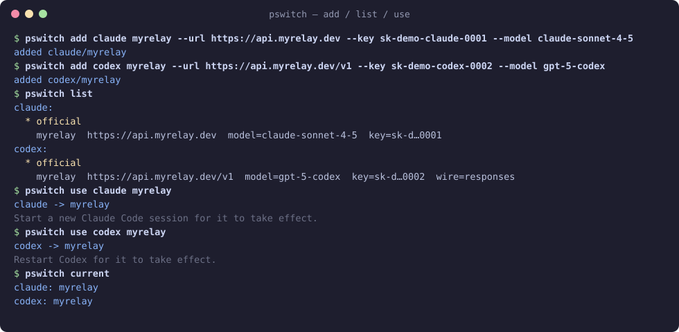
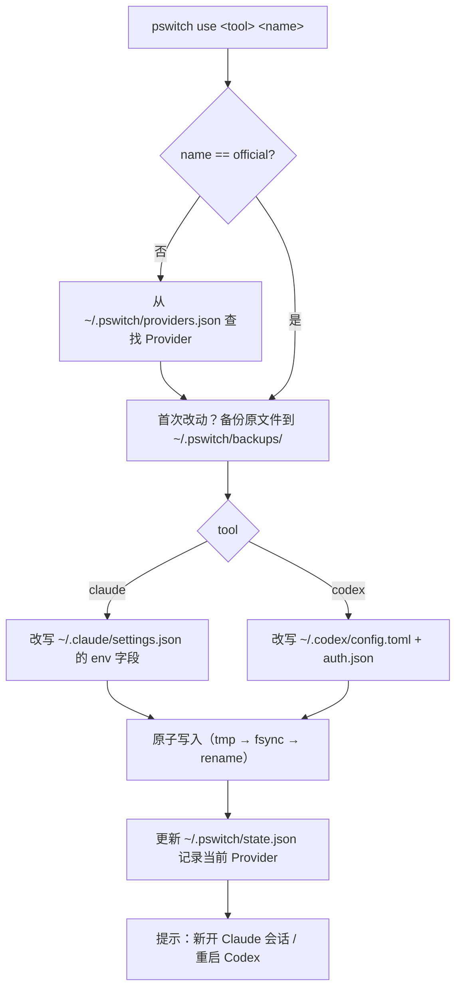
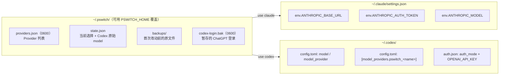
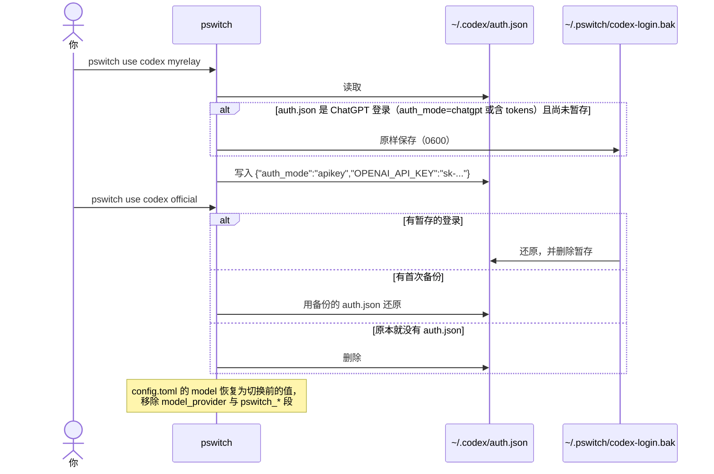
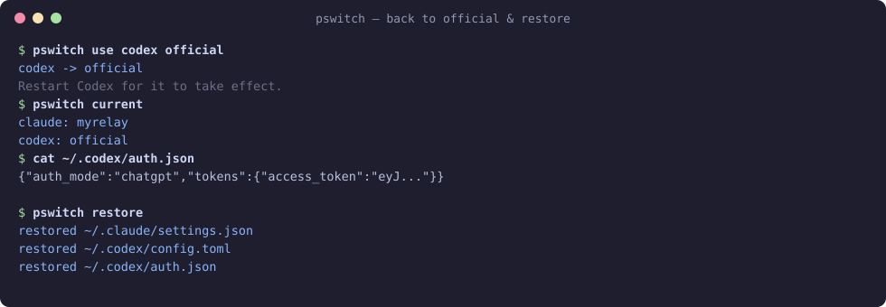

<div align="center">

# 🔀 pswitch

**给 Claude Code 和 Codex 一键切换模型 Provider 的极简命令行工具**

[](https://github.com/NotchL1118/pswitch/actions/workflows/ci.yml)




</div>

---

## ✨ 简介

`pswitch` 只做一件事：**把 Claude Code / Codex 指向另一个模型 Provider**。

它受 [cc-switch](https://github.com/farion1231/cc-switch) 启发，但去掉了路由、代理、聚合、格式转换等其他功能，只保留“直连切换”。

### 为什么要做它？

| | 路由 / 代理模式 | **pswitch（直连模式）** |
|---|---|---|
| 请求路径 | 工具 → 本地代理 → Provider | 工具 → Provider |
| 常驻进程 | 需要 | **不需要** |
| 代理挂了 / 端口被占 | 工具不可用 | **不存在这个问题** |
| 卸载切换器后 | 需先写回配置 | **工具照常可用** |
| 原理 | 改代理转发目标 | **直接改写工具自己的配置文件** |

- 🎯 **只支持 Claude Code 和 Codex**，不做别的。
- 🪶 单个二进制，没有运行时依赖，没有后台进程。
- 🧷 只改那几个关键字段，你的 permissions、hooks、MCP、注释都原样保留。

## 🚀 功能

- `add / list / remove` 管理 Provider 列表（Key 在列表中自动打码）
- `use <tool> <name>` 一键切换；`use <tool> official` 切回官方
- `current` 查看两个工具当前各自用的是哪个 Provider
- 首次改动前自动**备份**原始配置，`restore` 一键还原
- **原子写入**（临时文件 + fsync + rename），不会留下写一半的配置
- 含 Key 的文件权限为 **0600**
- Codex 的 **ChatGPT 官方登录自动暂存 / 还原**，切回官方无需重新 `codex login`
- 修改 TOML 使用 `toml_edit`，**保留格式与注释**

## 🧭 工作原理

### 切换流程



### 文件布局与被修改的字段



> pswitch 创建的 Codex provider 段统一以 `pswitch_` 为前缀，切换时只删除或替换带这个前缀的段，不会动你自己写的 `[model_providers.*]`。

### Codex 官方登录的暂存与还原



## 📦 安装

需要 Rust 工具链（stable）。

```bash
# 直接从 GitHub 安装
cargo install --git https://github.com/NotchL1118/pswitch

# 或从源码构建
git clone https://github.com/NotchL1118/pswitch
cd pswitch
cargo build --release
cp target/release/pswitch ~/.local/bin/   # 放到 PATH 里任意位置
```

## ⚡ 快速开始

```bash
# 1. 添加 Provider（Key 为示例）
pswitch add claude myrelay --url https://api.myrelay.dev    --key sk-demo-xxx --model claude-sonnet-4-5
pswitch add codex  myrelay --url https://api.myrelay.dev/v1 --key sk-demo-yyy --model gpt-5-codex

# 2. 切换
pswitch use claude myrelay   # 新开一个 Claude Code 会话即生效
pswitch use codex  myrelay   # 重启 Codex 即生效

# 3. 查看 / 切回
pswitch current
pswitch use codex official
```

切回官方与一键还原：



## 📖 命令参考

| 命令 | 说明 |
|---|---|
| `pswitch add <claude\|codex> <name> --url <URL> --key <KEY> --model <MODEL> [--wire responses\|chat]` | 添加 Provider。名称只能含 `[A-Za-z0-9_-]`，`official` 为保留名；同一工具下重名会报错。`--wire` 仅对 Codex 有效，默认 `responses`；对 claude 传入会被忽略；传 `chat` 会给出警告 |
| `pswitch list` | 按工具列出 Provider，`*` 标记当前项，Key 打码显示（如 `sk-d…0001`） |
| `pswitch current` | 显示 `claude: <name>` / `codex: <name>` |
| `pswitch use <claude\|codex> <name>` | 激活 Provider；`official` 切回官方配置 |
| `pswitch remove <claude\|codex> <name>` | 删除 Provider（正在使用的不能删，需先 `use ... official`） |
| `pswitch restore` | 把所有备份过的配置文件还原到首次改动前的样子，并清除状态与登录暂存 |
| `pswitch --help` / `--version` | 帮助 / 版本 |

环境变量：`PSWITCH_HOME` 可覆盖数据目录（默认 `~/.pswitch`）。

## 🔍 配置文件改动前后对比

### `~/.claude/settings.json`

<table><tr><th>切换前</th><th>pswitch use claude myrelay 之后</th></tr><tr><td>

```json
{
  "permissions": {
    "allow": ["Bash(git status)"]
  },
  "env": {
    "DISABLE_TELEMETRY": "1"
  }
}
```

</td><td>

```json
{
  "permissions": {
    "allow": ["Bash(git status)"]
  },
  "env": {
    "DISABLE_TELEMETRY": "1",
    "ANTHROPIC_BASE_URL": "https://api.myrelay.dev",
    "ANTHROPIC_AUTH_TOKEN": "sk-demo-claude-0001",
    "ANTHROPIC_MODEL": "claude-sonnet-4-5"
  }
}
```

</td></tr></table>

`use claude official` 会从 `env` 里删掉这三个键，其他内容不变。

### `~/.codex/config.toml`

<table><tr><th>切换前</th><th>pswitch use codex myrelay 之后</th></tr><tr><td>

```toml
# my codex config
model = "gpt-5" # default model

[mcp_servers.docs]
command = "docs-mcp"
```

</td><td>

```toml
# my codex config
model = "gpt-5-codex" # default model
model_provider = "pswitch_myrelay"

[mcp_servers.docs]
command = "docs-mcp"

[model_providers.pswitch_myrelay]
name = "myrelay"
base_url = "https://api.myrelay.dev/v1"
wire_api = "responses"
requires_openai_auth = true
```

</td></tr></table>

注释、MCP 配置原样保留；切回 official 时 `model` 恢复为 `"gpt-5"`。

### `~/.codex/auth.json`

<table><tr><th>切换前（ChatGPT 登录）</th><th>切换后</th></tr><tr><td>

```json
{"auth_mode":"chatgpt","tokens":{"access_token":"eyJ..."}}
```

</td><td>

```json
{
  "auth_mode": "apikey",
  "OPENAI_API_KEY": "sk-demo-codex-0002"
}
```

</td></tr></table>

原来的登录会暂存到 `~/.pswitch/codex-login.bak`，切回 official 时原样写回。

## 🛡️ 安全设计

- **首次备份**：每个配置文件在第一次被修改前复制到 `~/.pswitch/backups/`（原本不存在的文件记为 `.absent` 标记，还原时会删除）。备份只做一次，不会被后续切换覆盖。
- **原子写入**：先写同目录临时文件并 `fsync`，再 `rename` 覆盖，工具不会读到写了一半的文件。
- **权限 0600**：`providers.json`、`settings.json`、`auth.json`、备份和登录暂存都以 0600 写入；`config.toml` 保留原权限。
- **一键还原**：`pswitch restore` 把一切恢复到首次改动前。
- **无网络、无代理**：pswitch 本身不发任何网络请求。

## ❓ FAQ

**切换后 Codex 没生效？**
Codex 只在启动时读配置，需要完全重启（包括后台进程）。Claude Code 新开一个会话即可。

**`--wire chat` 能用吗？**
新版 Codex 已移除 `wire_api = "chat"`，只支持 `responses`（OpenAI Responses API）。pswitch 仍允许填写 `chat` 以兼容旧版，但会打印警告。Provider 需要支持 Responses API。

**`requires_openai_auth = true` 是做什么的？**
让 Codex 从 `~/.codex/auth.json` 里的 `OPENAI_API_KEY` 读取 Key，而不用你另外设置环境变量。所以切换时 pswitch 会同时写 `auth.json`。

**Claude Code 用的是 `ANTHROPIC_AUTH_TOKEN` 还是 `ANTHROPIC_API_KEY`？**
pswitch 写入的是 `ANTHROPIC_AUTH_TOKEN`（以 `Authorization: Bearer` 发送），大多数中转服务都支持。

**会动我自己写的 `[model_providers.xxx]` 吗？**
不会，只处理 `pswitch_` 前缀的段。

**测坏了怎么办？**
运行 `pswitch restore`。

## 🗺️ Roadmap

- [x] 核心 CLI：add / list / current / use / remove / restore
- [x] 备份、原子写入、Codex 登录暂存
- [ ] Tauri 托盘 GUI：每个工具一行，点一下即切换（复用同一套 Rust 核心）
- [ ] `pswitch edit` 修改已有 Provider
- [ ] 预编译二进制（GitHub Releases）

## 📄 License

[MIT](LICENSE)
